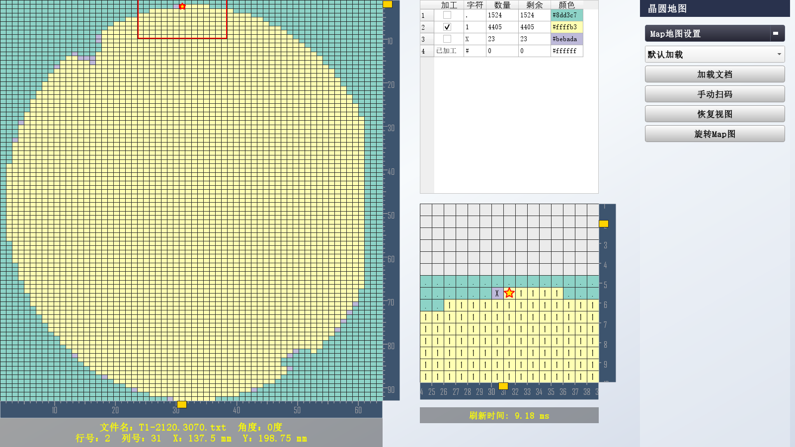

# QT Wafer Map

[中文](README.md) | English

A Qt/C++ wafer map viewer, editor and traversal planner. It supports text, CSV and Excel maps and exposes a reusable `WaferMapWindow` component.



## Contents

- [Overview](#overview)
- [Features](#features)
- [UI Modules](#ui-modules)
- [Requirements](#requirements)
- [Quick Start](#quick-start)
- [Typical Workflow](#typical-workflow)
- [Supported Inputs](#supported-inputs)
- [Using the Window](#using-the-window)
- [Load Options](#load-options)
- [Physical Coordinate Mapping](#physical-coordinate-mapping)
- [Signals and Coordinates](#signals-and-coordinates)
- [Layout](#layout)
- [Development Notes](#development-notes)
- [Known Limitations](#known-limitations)
- [License](#license)

## Overview

QT Wafer Map targets engineers and developers who inspect, validate and edit text-based wafer maps. It converts row/column/bin data into an interactive grid with overview and local views, coordinate rulers, bin statistics, alignment points, start-point discovery, serpentine path planning and map editing.

Typical uses:

- Parse and verify map files.
- Check row/column and cell coordinates.
- Validate processing paths and start points.
- Inspect map data on an engineering workstation.
- Embed a map window in another Qt application.

## Features

- **Formats**: plain text, `.map`, `.csv`, `.xlsx`, `.xlsm`, `.xltx`.
- **Loading modes**: auto-detect, custom text range, CSV column mapping, Excel worksheet/range.
- **Map viewer**: synchronized overview/local views, wheel zoom, drag pan, coordinate rulers, current-cell highlight.
- **Rotation**: 0°, 90°, 180°, 270° display rotation.
- **Bin statistics**: colors, totals, processed/remaining counts, target selection.
- **Alignment**: start point, one reference point, multiple verification points.
- **Start discovery**: step-by-step route through reference/verification points to the start point.
- **Serpentine planning**: eight horizontal/vertical directions with normal and assist paths.
- **Editing**: point, rectangle and circle selection; change bins or crop a region.
- **Scan search**: find a map file from raw barcode/scan text.
- **Reusable API**: loading, in-memory data, queries, selection, rotation, alignment, path planning and signals.
- **Stable colors**: deterministic palette and contrast-aware text color.
- **Physical coordinates**: map source rows/columns to physical X/Y and show them in the map info.
- **Refresh timing**: show the last map repaint time in the bottom status label.

## UI Modules

| Module | Purpose |
| --- | --- |
| Main map | Full map view, zoom/pan, coordinate selection; red box marks the current cell |
| Local map | 15×15 neighborhood around the current cell |
| Bin table | Bin colors/counts and processing-target selection |
| Map Settings | Loading mode, load file, rotation and view reset |
| Map Alignment | Direction, start/reference/verification points, start discovery |
| Path Planning | Start/stop serpentine pickup planning |
| Map Editing | Point, rectangle or circular selection and editing |

## Requirements

- Windows is the primary tested platform.
- Qt 5.12+; Qt 6 code paths are included (Qt 6 uses C++17, Qt 5 uses C++11).
- MSVC and MinGW are supported; the default configuration is MSVC.
- Both Qt 5.15.2 and Qt 6.5.3 have been compiled; the Qt 6.6+ private-header path is selected by version but was not verified locally.
- Excel loading uses Qt private headers: Qt 5 and Qt 6.0–6.5 use `QtGui/private/qzipreader_p.h`; Qt 6.6+ uses `QtCore/private/qzipreader_p.h`. Install the private headers matching the Qt version.
- Keep sources UTF-8 on Windows. CMake/qmake enable `/utf-8`, and public headers include a UTF-8 BOM.

## Quick Start

### qmake

```powershell
git clone https://github.com/735754647/QT-Wafer-Map.git
cd QT-Wafer-Map\MapTest

qmake QTWaferMap.pro
nmake          # or mingw32-make
.\bin\QTWaferMap.exe
```

### CMake (optional)

From the repository root:

```powershell
cmake -S MapTest -B build -G "Visual Studio 17 2022" -A Win32 `
  -DCMAKE_PREFIX_PATH=C:/Qt/5.15.2/msvc2019

cmake --build build --config Release
.\build\bin\Release\QTWaferMap.exe
```

Use `-A Win32` for 32-bit Qt and `-A x64` for 64-bit Qt. The architecture must match the Qt kit.

### Open a map at startup

```powershell
.\MapTest\bin\QTWaferMap.exe ".\地图文件\T1-2120.3070.txt"
```

### Save a window snapshot

```powershell
.\MapTest\bin\QTWaferMap.exe ".\地图文件\T1-2120.3070.txt" --screenshot demo.png
```

The screenshot mode waits for layout, saves the image and exits. It does not show a modal dialog on load failure, so it can be used unattended.

### Command line

| Option | Description |
| --- | --- |
| `map` | Optional map file to open at startup |
| `--csv` | Force CSV loading |
| `--screenshot <file>` | Save a window snapshot and exit |
| `--help` | Show help |
| `--version` | Show version |

## Typical Workflow

1. Start the application and choose a loading mode in **Map Settings**.
2. Click **Load File** and select a map.
3. Configure the source layout:
   - Text/map: start/end row, start/end column, bin width.
   - CSV: data start row and X/Y/bin columns.
   - Excel: worksheet index and cell range.
4. Check the bin table and select target bins for processing.
5. Set direction, start point, reference point and verification points in **Map Alignment**.
6. Run **Find Start**; after reaching the start point, click **Start Planning**.
7. To edit, use **Map Editing** and choose point, rectangle or circle selection.
8. **Rotate Map** rotates the display by 90°; **Reset View** restores zoom and pan.

The main map supports wheel zoom and drag pan. **Manual Scan** searches for a map file using scan text.

## Supported Inputs

| Format | Mode | Notes |
| --- | --- | --- |
| `.txt` / `.map` | Default | Auto-detect common map body, range and bin width |
| `.txt` / `.map` | Custom | Explicit start/end row/column and bin character count |
| `.csv` | CSV | Data start row and X/Y/bin columns; columns are 0-based |
| `.xlsx` | Excel | Worksheet index and cell range |
| `.xlsm` / `.xltx` | Excel | Office Open XML input |
| In-memory data | `setMapData()` | `QVector<QStringList>`, no temporary file |

The `地图文件/` directory contains sample maps from several vendors. Layouts vary; adjust the load configuration when auto-detection does not fit.

## Using the Window

`WaferMapWindow` is a self-contained `QMainWindow`. It can be the main window of a program or embedded in another Qt application.

```cpp
#include <WaferMapWindow.h>

#include <QApplication>

int main(int argc, char* argv[])
{
    QApplication app(argc, argv);

    WaferMapWindow window;
    QString error;

    if (!window.loadMapFile("wafer.txt", &error)) {
        qWarning("load failed: %s", qPrintable(error));
        return 1;
    }

    window.selectDisplayCell(10, 20);                 // 0-based display coordinates
    window.setMapDirection(LeftToRightTopToBottom);
    window.show();

    return app.exec();
}
```

### In-memory data

```cpp
QVector<QStringList> rows;
rows << (QStringList() << "1" << "1" << "2")
     << (QStringList() << "1" << "3" << "2")
     << (QStringList() << "3" << "3" << " ");

QString error;
if (!window.setMapData(rows, &error)) {
    qWarning("load failed: %s", qPrintable(error));
}
```

Empty cells and missing trailing columns are normalized to blank bins.

### CMake subdirectory

```cmake
add_subdirectory(path/to/QT-Wafer-Map/MapTest)

add_executable(my_tool main.cpp)
target_link_libraries(my_tool PRIVATE QTWaferMap::QTWaferMap)
```

> The library target is `QTWaferMap`; the alias is `QTWaferMap::QTWaferMap`.

If only the library is needed, build the `QTWaferMap` target.

## Load Options

Default loading auto-detects the range:

```cpp
QString error;
if (!window.loadMapFile("wafer.txt", &error)) {
    qWarning("load failed: %s", qPrintable(error));
}
```

For fully non-interactive loading, use `MapLoadOptions`:

```cpp
MapLoadOptions options;
options.mode = CustomLoadMode;
options.range.startRow = 0;
options.range.endRow = 99;
options.range.startColumn = 0;
options.range.endColumn = 99;
options.binCharCount = 1;

QString error;
if (!window.loadMapFile("wafer.txt", options, &error)) {
    qWarning("load failed: %s", qPrintable(error));
}
```

CSV:

```cpp
MapLoadOptions csv;
csv.mode = CsvLoadMode;
csv.csvDataStartRow = 1;  // 0-based; default 1 skips a header row
csv.csvXColumn = 0;
csv.csvYColumn = 1;
csv.csvBinColumn = 2;
```

Excel:

```cpp
MapLoadOptions excel;
excel.mode = ExcelLoadMode;
excel.excelSheetIndex = 0;
excel.range.startRow = 1;
excel.range.endRow = 100;
excel.range.startColumn = 1;
excel.range.endColumn = 80;
```

| Field | Description |
| --- | --- |
| `mode` | `DefaultLoadMode`, `CsvLoadMode`, `CustomLoadMode`, `ExcelLoadMode` |
| `range` | Inclusive 0-based range for text/custom/Excel loading |
| `binCharCount` | Characters per bin in text/custom mode, 1–4 |
| `csvDataStartRow` | 0-based CSV data start row |
| `csvXColumn` / `csvYColumn` / `csvBinColumn` | 0-based CSV columns |
| `excelSheetIndex` | 0-based worksheet index |

`.xlsx`, `.xlsm` and `.xltx` always use the Excel reader, even if another mode is requested.

## Physical Coordinate Mapping

Wafer maps often need physical equipment X/Y coordinates in addition to row/column indices.

### External per-cell data

If the equipment already provides exact coordinates for each die, bind them to source cells:

```cpp
QVector<WaferMapPhysicalPoint> points;
points.append(WaferMapPhysicalPoint{QPoint(0, 0), QPointF(100.0, 200.0)});
points.append(WaferMapPhysicalPoint{QPoint(1, 0), QPointF(101.25, 200.0)});
points.append(WaferMapPhysicalPoint{QPoint(0, 1), QPointF(100.0, 198.75)});

window.setPhysicalCoordinateData(points);
QPointF currentXY = window.currentPhysicalCoordinate();
```

Exact bound data takes priority over the linear mapping. Clear the external table with:

```cpp
window.clearPhysicalCoordinateData();
```

### Linear mapping

For regular grids, use:

```text
X = originX + sourceColumn × stepX
Y = originY + sourceRow × stepY
```

```cpp
MapCoordinateMapping mapping;
mapping.enabled = true;
mapping.originX = 10.0;
mapping.originY = 20.0;
mapping.stepX = 0.5;
mapping.stepY = -0.5;
mapping.unit = "mm";

window.setCoordinateMapping(mapping);
QPointF cellXY = window.sourceToPhysical(column, row);
```

`sourceColumn` / `sourceRow` are 0-based source coordinates and are independent of display rotation. Set `mapping.enabled = true` when X/Y should appear in the map information.

## Signals and Coordinates

| Signal | When |
| --- | --- |
| `mapLoaded(QString filePath)` | A file or in-memory map loaded; path is empty for in-memory data |
| `mapLoadFailed(QString errorMessage)` | Loading failed; also available via `lastError()` |
| `currentCellChanged(int column, int row)` | Selected display cell changed |
| `directionChanged(Direction direction)` | Traversal direction changed |
| `rotationChanged(int degrees)` | Display rotation changed |
| `mapEdited()` | An edit modified map cells |

Coordinates:

- All public coordinates are 0-based.
- `selectDisplayCell()` / `currentDisplayCell()` use display coordinates after rotation.
- `sourceCellValue()` / `displayCellValue()` read source/display cells.
- `startPoint()`, `referencePoint()` and `verifyPoints()` use source coordinates.
- Rotation affects only drawing/display coordinates; direction is used by path planning.

## Layout

```text
.
├── MapTest/
│   ├── include/              # Public headers
│   │   ├── MapTypes.h        # Enums, load options, bin statistics
│   │   ├── QTWaferMapGlobal.h # Export macro and version
│   │   └── WaferMapWindow.h  # Public window API
│   ├── src/
│   │   ├── main.cpp          # Desktop entry point
│   │   ├── WaferMapWindow.cpp # Loading, rendering, interaction, planning
│   │   ├── WaferMapWindow.ui # Main window layout
│   │   ├── RulerSlider.cpp   # Coordinate ruler
│   │   └── RulerSlider.h
│   ├── CMakeLists.txt        # Optional CMake build
│   └── QTWaferMap.pro        # qmake project
├── 地图文件/                 # Sample maps
├── screenshot.png
├── .gitignore
├── LICENSE
├── README.md
└── README.en.md
```

## Development Notes

- Entry point: `MapTest/src/main.cpp`.
- Window and map logic: `MapTest/src/WaferMapWindow.cpp`, `MapTest/include/WaferMapWindow.h`.
- UI form: `MapTest/src/WaferMapWindow.ui`.
- Coordinate ruler: `MapTest/src/RulerSlider.*`.
- Public types and load options: `MapTest/include/MapTypes.h`.
- qmake defines `QTWAFERMAP_STATIC`; the CMake static library exports the same define.
- CMake looks for Qt 6 first and falls back to Qt 5; Qt 6 uses C++17 and Qt 5 uses C++11.
- Qt 6.6 moved `QZipReader` to the QtCore private headers; the source and build files select the path by Qt version.
- The overview uses a one-pixel-per-cell `QImage` cache when zoomed out and draws text/grid only when zoomed in.
- The bottom status label shows the last repaint time after rendering.
- C++ files containing Chinese use UTF-8 BOM; MSVC targets also enable `/utf-8`.
- Text, CSV, Excel and in-memory input share the same normalization, bin statistics and view refresh path.

## Known Limitations

- Qt 6.5.3 is compiled and smoke-tested. Qt 6.6+ selects the `QZipReader` Core private header by version, but should be verified with the target Qt version.
- Excel supports Office Open XML only; legacy `.xls` is unsupported.
- Excel loading depends on Qt private APIs; check `QZipReader` when upgrading Qt.
- `WaferMapWindow.cpp` is still large: loading, rendering and planning live in one translation unit and can be split further.
- The component is a full main window, not a lightweight canvas.
- No physical wafer outline or process-parameter derivation from measurement data.

## License

This project is licensed under the [MIT License](LICENSE).
